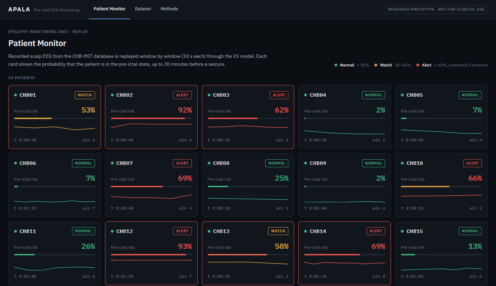

# What-to-do-

A single-page personal portfolio site for Mrittunjay Dubey, built as one static HTML file with inline CSS.

## Features

- One self-contained `index.html` (no build step)
- Dark theme, an "About me" section and a "Case files" section listing projects
- Google Fonts loaded from the web (Anek Devanagari, Anek Latin, Hind, IBM Plex Mono)

## Demo / Screenshots



## Tech stack

HTML and CSS only.

## Getting started

No installation is needed. Open `index.html` in a browser, or serve the folder locally:

```bash
python -m http.server 8000
# then open http://localhost:8000
```

An internet connection is needed for the web fonts.

## Project structure

```
index.html     the whole page (markup + styles)
dashboard.png  screenshot used in the page / README
logo.png       favicon
```

## Roadmap / known limitations

- The repository name is a leftover from early planning ("what to do"); the content is now a portfolio page.
- A separate React/Vite portfolio project lives in the [PortFolio](https://github.com/JayD108/PortFolio) repository.

## Author

Mrittunjay Dubey, GitHub [@JayD108](https://github.com/JayD108)

## License

No license file is included yet, so all rights are reserved by default.